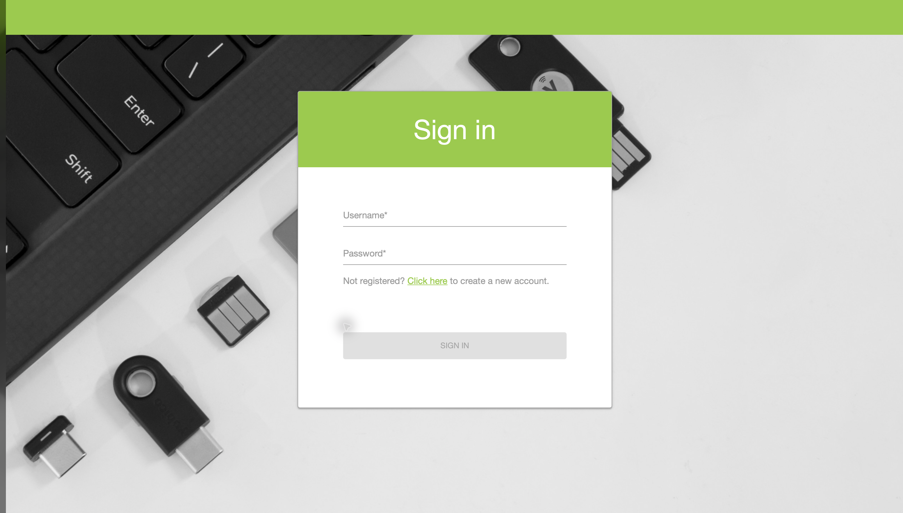
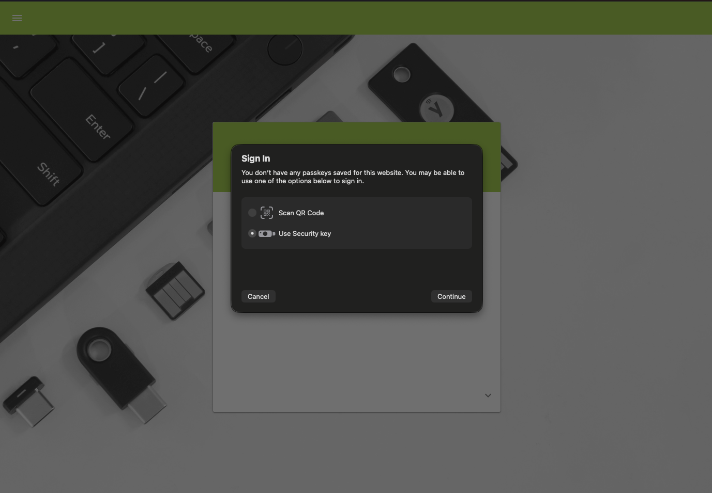

```bash
sudo python3 -m http.server --bind 127.0.0.1 80
```

# YubiKey WebAuthn Demo

A local demonstration of a security-key registration and sign-in flow using WebAuthn. The interface recreates the Yubico demo experience with locally saved HTML pages.

## Start the project

Open a terminal in the project directory:

```bash
cd /Users/simba/Downloads/test
sudo python3 -m http.server --bind 127.0.0.1 80
```

Enter your macOS password when prompted, then open:

```text
http://localhost/
```

Press `Ctrl+C` in the terminal to stop the server.

## Demo flow

1. Click **Start the WebAuthn Demo**.
2. Create a demo account or open **Sign in**.
3. Enter a test username and password.
4. Click **Sign In** to open the browser's native security-key dialog.
5. Select **Use Security Key** and continue.
6. If the key or credential is not found, or the operation is cancelled, the browser opens `tryagain.html`.
7. Click **Retry** to return to `index.html#signin`.

## Screenshots

### Sign in



### Choose a security key



### Credential not found


## Main files

- `index.html`: controls navigation and the local WebAuthn flow.
- `tryagain.html`: displays the failed-authentication screen and provides the Retry action.
- `Yubico demo website (...).html`: locally saved pages used as the visual background for each screen.
- `signin.png`: sign-in screen reference.
- `key.png`: native security-key selection dialog reference.
- `no found.png`: missing-credential dialog reference.

## Important notes

- Use `http://localhost/`. WebAuthn does not work correctly when `index.html` is opened directly with `file://`.
- Requests to `127.0.0.1` are automatically redirected to `localhost`.
- The demo does not send or store the entered username or password.
- The public identifier of a registered security key is stored only in `localStorage`.
- This is a local visual demonstration. It is not a replacement for a production WebAuthn implementation with server-generated challenges, session state, and cryptographic assertion verification.
- `python3 -m http.server` is suitable for local testing only, not production use.

## Troubleshooting

### Port 80 is already in use

Check which process is listening on port 80:

```bash
sudo lsof -nP -iTCP:80 -sTCP:LISTEN
```

### The security-key dialog does not appear

Confirm that the browser address is exactly `http://localhost/`, complete both sign-in fields, and click **Sign In** again.
